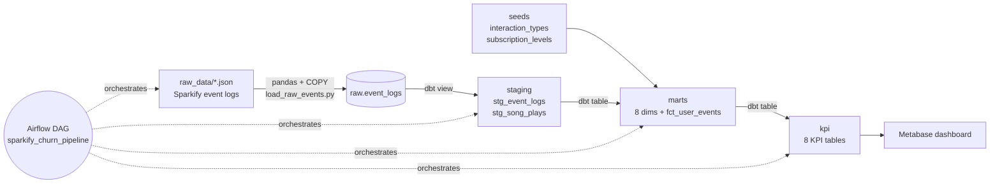

# 🎵 Sparkify — ระบบคลังข้อมูลเพื่อวิเคราะห์พฤติกรรมการสตรีมเพลงและการรักษาฐานสมาชิก
**Music Streaming Behavior & Subscription Churn Analytics Data Warehouse**

โปรเจกต์ปลายภาค DSBA8 Data Warehouse — ใช้ stack เดียวกับ lab ในรายวิชา
(**Docker · PostgreSQL 16 · Apache Airflow 3 · dbt · Metabase**) และโครงสร้างไฟล์แบบเดียวกับ `week01–week11` ใน repo

---

## 1. โจทย์ธุรกิจ (จากสไลด์)

| # | Business Question | ตอบด้วย model |
|---|---|---|
| 1 | ผู้ใช้งานมีพฤติกรรมการฟังอย่างไรในแต่ละช่วงเวลาของวัน | `kpi_listening_heatmap`, `kpi_listening_by_level`, `kpi_top_content_by_daypart` |
| 2 | สัญญาณเตือนพฤติกรรมแบบใดบ่งชี้ว่าผู้ใช้มีความเสี่ยงจะยกเลิกการใช้งาน | `kpi_user_churn_features`, `kpi_churn_signals`, `kpi_churn_funnel` |

---

## 2. โครงสร้างโฟลเดอร์

```
project-sparkify-churn-dw/
├── README.md                     ← ไฟล์นี้
├── docker-compose.yaml           ← stack ทั้งหมด (ดัดแปลงจาก week01, ย้าย port เป็น 3xxxx)
├── dockerfile.airflow            ← Airflow + dbt + pandas + psycopg2
├── postgresql.conf
├── .env.example                  ← AIRFLOW_UID
├── init/
│   └── 01_create_sparkify_db.sql ← สร้าง database sparkify_dw + schema raw ตอน Postgres เริ่มครั้งแรก
├── raw_data/
│   ├── README.md                 ← รูปแบบไฟล์ event log และวิธีเตรียมข้อมูล
│   └── 2018-11-01-events.json … 2018-11-30-events.json ← event logs ที่ pipeline โหลด
├── reference_data/
│   ├── log_data.zip              ← ไฟล์ต้นฉบับของ event logs
│   └── song_data.zip             ← metadata เพลง (pipeline ปัจจุบันยังไม่ใช้)
├── scripts/
│   ├── generate_sample_data.py   ← สร้างข้อมูลจำลอง (schema เหมือน Sparkify จริง)
│   └── load_raw_events.py        ← E+L: อ่าน JSON ด้วย pandas → COPY เข้า raw.event_logs
├── dags/
│   └── sparkify_churn_pipeline.py← Airflow DAG: check → load → dbt seed → staging → marts → kpi
├── dbt_root/
│   └── profiles.yml              ← การเชื่อมต่อ dbt → Postgres
├── dbt/sparkify_dw/              ← โปรเจกต์ dbt (Transform)
│   ├── dbt_project.yml           ← schema ของแต่ละชั้น + vars (CPM, skip threshold, lookback)
│   ├── macros/generate_schema_name.sql
│   ├── seeds/                    ← ตาราง lookup
│   │   ├── interaction_types.csv     (page → หมวดพฤติกรรม + flag)
│   │   └── subscription_levels.csv   (free / paid)
│   ├── models/
│   │   ├── staging/              ← ชั้นทำความสะอาด (view)
│   │   │   ├── sources.yml
│   │   │   ├── stg_event_logs.sql
│   │   │   └── stg_song_plays.sql
│   │   ├── marts/                ← Star schema (table)
│   │   │   ├── dim_datetime.sql  dim_user.sql  dim_song.sql  dim_artist.sql
│   │   │   ├── dim_device.sql    dim_location.sql  dim_subscription.sql  dim_interaction_type.sql
│   │   │   └── fct_user_events.sql
│   │   └── kpi/                  ← KPI layer สำหรับ dashboard (table)
│   │       ├── kpi_user_activity_daily.sql      kpi_listening_by_level.sql
│   │       ├── kpi_listening_heatmap.sql        kpi_top_content_by_daypart.sql
│   │       ├── kpi_churn_funnel.sql             kpi_user_churn_features.sql
│   │       ├── kpi_churn_signals.sql            kpi_free_tier_ads.sql
│   └── analyses/dashboard_queries.sql   ← SQL พร้อมวางใน Metabase
└── docs/
    └── star_schema.md            ← ER diagram + เหตุผลการออกแบบ
```

---

## 3. สถาปัตยกรรม / Data Flow



| ชั้น (schema) | ทำอะไร | ทำไมต้องมี |
|---|---|---|
| `raw` | เก็บข้อมูลจากไฟล์ตามต้นฉบับ (แค่เปลี่ยนชื่อคอลัมน์เป็น snake_case) | ถ้า logic ผิด สามารถ rebuild ใหม่ได้โดยไม่ต้องโหลดไฟล์ซ้ำ |
| `staging` | แปลง epoch ms → timestamp, ตัดผู้ใช้ที่ไม่ได้ login (`userId = ''`), ตัดแถวซ้ำ, คำนวณเวลาฟังจริง/การข้ามเพลง | ทำความสะอาดที่เดียว ทุก model ข้างบนใช้ต่อ |
| `ref` | seeds (lookup) | กฎธุรกิจที่แก้ได้ง่ายโดยไม่ต้องแก้ SQL |
| `marts` | Star schema: `fct_user_events` + 8 dimensions | แบบจำลองกลางสำหรับ slice/dice ทุกมุม |
| `kpi` | ตารางสรุปที่ตรงกับกราฟแต่ละตัว | dashboard query เร็ว, นิยาม KPI อยู่ใน code (ไม่กระจายใน BI) |

---

## 4. Dimensional Model (ตรงกับสไลด์หน้า 6)

**Grain:** 1 แถวต่อ 1 เหตุการณ์การฟังเพลงหรือการกดปฏิสัมพันธ์บนระบบ — รายละเอียดเต็มอยู่ใน [`docs/star_schema.md`](docs/star_schema.md)

| สไลด์ | Model | หมายเหตุ |
|---|---|---|
| date_time — เมื่อไหร่ | `dim_datetime` | grain ชั่วโมง, มี `day_part` (Morning 05–11 / Afternoon 12–16 / Evening 17–21 / Late Night 22–04) และ `day_part_th` (เช้า/บ่าย/เย็น/ดึก) |
| dim_user — เข้าใจผู้ใช้ | `dim_user` | เพศ, วันสมัคร, level ปัจจุบัน, `is_churned`, `tenure_days` |
| dim_song — เพลงอะไร | `dim_song` | ชื่อเพลง, ศิลปิน, ความยาว, `length_band` |
| dim_artist — เพลงของใคร | `dim_artist` | log ไม่มี location ของศิลปิน (ดูหมายเหตุข้อ 9) |
| dim_device — ใช้ผ่านอะไร | `dim_device` | แยก OS / Browser / Desktop-Mobile-Tablet จาก user agent |
| dim_location — ฟังจากไหน | `dim_location` | metro area, city, state, country |
| dim_subscription — ผู้ใช้แบบไหน | `dim_subscription` | Free/Paid **ณ เวลาที่เกิด event** |
| dim_interaction — ฟังเพลงยังไง | `dim_interaction_type` | page → หมวด (Playback, Feedback, Advertising, Subscription, Churn …) |
| Fact Table / Measures | `fct_user_events` | ความยาวเพลง, เวลาฟังจริง, การข้ามเพลง, Like/Dislike, โฆษณา, อัปเกรด, ยกเลิก |

Bus matrix ในสไลด์หน้า 8 ถูก implement ครบ — ทุก business process ใช้ fact ตัวเดียวกันและ dimension ร่วมกัน (conformed dimensions)

---

## 5. KPI → Model → กราฟ (ตรงกับสไลด์หน้า 7)

| Subject Area | KPI | Model | Visualization |
|---|---|---|---|
| User Engagement | DAU / MAU (rolling 30 วัน), stickiness = DAU÷MAU | `kpi_user_activity_daily` | Line chart |
| Music Consumption | สัดส่วนชั่วโมงการฟัง Free vs Paid | `kpi_listening_by_level` | 100% stacked bar |
| Music Consumption | Top 10 เพลง/ศิลปินในแต่ละช่วงเวลา (เช้า บ่าย เย็น ดึก) | `kpi_top_content_by_daypart` | Horizontal bar |
| Customer Retention | Churn funnel + churn rate ของแต่ละกลุ่มพฤติกรรม | `kpi_churn_funnel` | Funnel chart |
| Free-Tier Commercial | Ad impressions, % ผู้ใช้ฟรีที่อัปเกรดหลังเห็นโฆษณา, รายได้โฆษณาโดยประมาณ | `kpi_free_tier_ads` | KPI cards |
| (เพิ่ม) Business Q1 | การฟังตามวัน × ชั่วโมง | `kpi_listening_heatmap` | Heatmap / Pivot |
| (เพิ่ม) Business Q2 | พฤติกรรมช่วง 14 วันก่อนยกเลิก + `churn_risk_score` | `kpi_user_churn_features`, `kpi_churn_signals` | Churn Risk Monitor (table) |

**นิยามสำคัญ**
- **Skip:** เพลงถัดไปในเซสชันเริ่มก่อนฟังครบ 50% ของความยาวเพลง (`vars.skip_threshold_ratio`)
- **Churn:** มี event `Cancellation Confirmation`
- **Churn signals:** วัดในช่วง 14 วันสุดท้ายก่อนยกเลิก (ผู้ใช้ที่ยังอยู่วัด 14 วันสุดท้ายก่อน event ล่าสุด) เพื่อให้เปรียบเทียบกันได้ยุติธรรม (`vars.churn_lookback_days`)
- **รายได้โฆษณา:** impressions × CPM ÷ 1000 — CPM = 10 USD เป็น **สมมติฐาน** แก้ได้ที่ `vars.ad_cpm_usd`
- **churn_risk_score (0–100):** คะแนนแบบกฎ (rule-based) จาก thumbs-down share, skip rate, songs/session, ads/100 songs, support events, active days

---

## 6. วิธีรัน

**ต้องมี:** Docker Desktop, RAM ≥ 4 GB, disk ≥ 10 GB

```bash
cd project-sparkify-churn-dw
echo -e "AIRFLOW_UID=$(id -u)" > .env       # Windows: copy .env.example .env
docker compose up -d --build               # ครั้งแรกใช้เวลาสักพัก (build image Airflow)
```

| บริการ | URL | Login |
|---|---|---|
| Airflow | http://localhost:38080 | airflow / airflow |
| Metabase | http://localhost:33000 | สร้างบัญชีตอนเปิดครั้งแรก |
| pgAdmin | http://localhost:38880 | dw_user@mail.com / dw_pass |
| PostgreSQL | localhost:35432 | dw_user / dw_pass · db `sparkify_dw` |

### ทางที่ 1 — รันผ่าน Airflow (แนะนำ)
1. เปิด Airflow → DAG `sparkify_churn_pipeline` → กด unpause → **Trigger**
2. ดูทุก task เป็นสีเขียว: `check_raw_files → load_raw_events → dbt_seed → dbt_build_staging → dbt_build_marts → dbt_build_kpi → dbt_docs_generate`

### ทางที่ 2 — รัน dbt เองใน container
```bash
python scripts/load_raw_events.py --host localhost --port 35432   # โหลด raw (ต้องมี pandas, psycopg2 บนเครื่อง)
docker exec -it sparkify_dbt bash
cd sparkify_dw
dbt seed; dbt build                  # run + test ทุก model
dbt docs generate && dbt docs serve --port 8080 --host 0.0.0.0   # เปิด http://localhost:38088
```

### ต่อ Metabase
Add database → PostgreSQL · Host `postgres` · Port `5432` · DB `sparkify_dw` · User `dw_user` / `dw_pass`
แล้วสร้าง question จากตารางใน schema `kpi` (หรือวาง SQL จาก `dbt/sparkify_dw/analyses/dashboard_queries.sql`)

---

## 7. Data Quality (dbt tests)

- `unique` + `not_null` บน primary key ของทุก dim, fact และ seed
- `relationships` จาก **ทุก FK** ใน `fct_user_events` ไปยัง dimension (ไม่มี orphan rows)
- `accepted_values` ของ `level` ∈ {free, paid}
- `relationships` จาก `stg_event_logs.page` → seed `interaction_types` — ถ้าข้อมูลใหม่มี page ที่ไม่รู้จัก pipeline จะหยุดที่ staging

---

## 8. ผลลัพธ์จากข้อมูลตัวอย่าง (synthetic — ใช้ทดสอบ pipeline)

ทดสอบรันครบทุก model บน PostgreSQL 16 แล้ว: 187,606 events ใน fact, 250 users, tests ผ่านทั้งหมด

| ตัวชี้วัด (14 วันสุดท้าย) | Churned (60 คน) | Retained (190 คน) |
|---|---|---|
| เพลงต่อเซสชัน | 12.7 | 21.3 |
| Skip rate | 26.4% | 9.6% |
| สัดส่วน Thumbs Down | 69.8% | 20.7% |
| โฆษณาต่อ 100 เพลง | 6.4 | 2.7 |
| churn_risk_score เฉลี่ย | 65.8 | 8.1 |

- ช่วง **Evening (17–21 น.)** มียอดเล่นเพลงสูงสุด
- กลุ่มที่กด Thumbs Down มาก มี churn rate 76% เทียบกับค่าฐาน 24%

> ⚠️ ตัวเลขในตารางนี้มาจาก **ข้อมูลจำลอง** เพื่อทดสอบ dashboard ไม่ใช่ผลจาก event logs ปัจจุบันใน `raw_data/` หากต้องการผลจากข้อมูลชุดปัจจุบัน ให้รัน pipeline ใหม่และใช้ผลลัพธ์ที่ได้แทน ตัว loader จะอ่าน event files ที่รองรับทั้งหมดจากระดับบนสุดของ `raw_data/` แล้วรวมข้อมูลเข้าด้วยกัน

---

## 9. ข้อจำกัด / สิ่งที่ต่อยอดได้

- **เวลาเป็น UTC** ตามต้นฉบับ — ถ้าต้องการเวลาท้องถิ่นของผู้ใช้ต้อง map state → timezone เพิ่ม
- **Artist location** ไม่มีใน event log; เพิ่มได้ถ้าโหลด song metadata dataset ของ Sparkify มาเป็น source ที่สอง
- `dim_user` เป็น SCD Type 1 — ถ้าต้องการประวัติ level ทำเป็น SCD Type 2 ด้วย `dbt snapshot` (ตาม week06/week09)
- `fct_user_events` เป็น full refresh — ข้อมูลใหญ่ขึ้นเปลี่ยนเป็น `materialized='incremental'` ตาม week09 ได้
- `churn_risk_score` เป็นกฎง่าย ๆ — ต่อยอดเป็นโมเดล ML (Logistic Regression) โดยใช้ `kpi_user_churn_features` เป็น feature table ได้ทันที
- อยากใช้ Power BI แทน Metabase: ต่อ PostgreSQL `localhost:35432` แล้วใช้ตารางใน schema `kpi` ได้เหมือนกัน

---

## 👥 ทีม

| รหัส | ชื่อ |
|---|---|
| 67070048 | ณัฐกฤตา วังวิเศษ |
| 67070068 | ธนภัทร เดชรักษา |
| 67070077 | ธิญารัจน์ เตชธรรมเศรษฐ์ |
| 67070219 | ชิดชนก สอนสุข |
| 67070257 | พัต พลสิทธินาถ |
| 670700258 | พัทธ์ธีรา จินดาพรรณ |
