# Star Schema — Sparkify Streaming & Churn DW

**Grain ของ fact:** 1 แถว = 1 เหตุการณ์ (event) ที่ผู้ใช้ที่ login แล้วทำบนแอป — การฟังเพลง (NextSong) หรือการกดปฏิสัมพันธ์ (Thumbs Up/Down, Add to Playlist, Roll Advert, Upgrade, Cancel …)

```mermaid
erDiagram
    fct_user_events }o--|| dim_datetime         : datetime_key
    fct_user_events }o--|| dim_user             : user_key
    fct_user_events }o--|| dim_song             : song_key
    fct_user_events }o--|| dim_artist           : artist_key
    fct_user_events }o--|| dim_device           : device_key
    fct_user_events }o--|| dim_location         : location_key
    fct_user_events }o--|| dim_subscription     : subscription_key
    fct_user_events }o--|| dim_interaction_type : interaction_type_key

    fct_user_events {
        text event_id PK
        bigint datetime_key FK
        text user_key FK
        text song_key FK
        text artist_key FK
        text device_key FK
        text location_key FK
        text subscription_key FK
        text interaction_type_key FK
        bigint session_id "degenerate dim"
        int item_in_session "degenerate dim"
        numeric song_length_sec "measure"
        numeric listened_sec "measure"
        int is_song_play "measure 0/1"
        int is_skipped "measure 0/1"
        int is_thumbs_up "measure 0/1"
        int is_thumbs_down "measure 0/1"
        int is_add_to_playlist "measure 0/1"
        int is_ad_impression "measure 0/1"
        int is_upgrade "measure 0/1"
        int is_downgrade "measure 0/1"
        int is_cancel_visit "measure 0/1"
        int is_churn "measure 0/1"
        int is_error "measure 0/1"
        int is_help_visit "measure 0/1"
    }
    dim_datetime {
        bigint datetime_key PK "YYYYMMDDHH"
        date full_date
        int hour_of_day
        text day_part "Morning/Afternoon/Evening/Late Night"
        text day_name
        bool is_weekend
    }
    dim_user {
        text user_key PK
        text user_id
        text gender
        text current_level
        bool is_churned
        int tenure_days
    }
    dim_song {
        text song_key PK
        text song_title
        text artist_name
        numeric song_length_sec
        text length_band
    }
    dim_artist {
        text artist_key PK
        text artist_name
        int songs_in_catalog
    }
    dim_device {
        text device_key PK
        text operating_system
        text browser
        text device_type
    }
    dim_location {
        text location_key PK
        text city
        text primary_state
        text country
    }
    dim_subscription {
        text subscription_key PK
        text level "free / paid"
        bool is_ad_supported
        numeric monthly_fee_usd
    }
    dim_interaction_type {
        text interaction_type_key PK
        text page
        text interaction_category
        bool is_churn_signal
    }
```

## การออกแบบที่ควรรู้

| เรื่อง | ทำอย่างไร | เหตุผล |
|---|---|---|
| Surrogate key | `md5(natural key)` | deterministic — โหลดซ้ำได้ key เดิม, ไม่ต้องพึ่ง sequence |
| Unknown member | key `'-1'` ใน dim_song / dim_artist / dim_device / dim_location | event ที่ไม่ใช่เพลง (เช่น Thumbs Up) ไม่มีเพลง → FK ไม่เป็น NULL และ inner join ไม่ทำแถวหาย |
| Measures | flag 0/1 + วินาที | additive ทั้งหมด → ทุก KPI คือ `SUM` / `COUNT` |
| `listened_sec`, `is_skipped` | คำนวณจากเวลาเริ่มเพลงถัดไปในเซสชันเดียวกัน (window `LEAD`) | log มีแค่เวลาเริ่มเพลง ไม่มีเวลาหยุด |
| dim_subscription | ผูกกับ **level ณ เวลาเกิด event** ไม่ใช่ level ปัจจุบันของผู้ใช้ | ผู้ใช้คนเดียวอาจฟังทั้งแบบ free และ paid ในช่วงข้อมูล |
| dim_datetime | grain รายชั่วโมง | ตอบคำถาม "ช่วงเวลาของวัน" โดยตรง และยัง roll-up เป็นวัน/สัปดาห์/เดือนได้ |
| dim_artist | ไม่มี location ของศิลปิน | event log ไม่มีฟิลด์นี้ (อยู่ใน song metadata อีกชุดหนึ่งของ Sparkify) |
